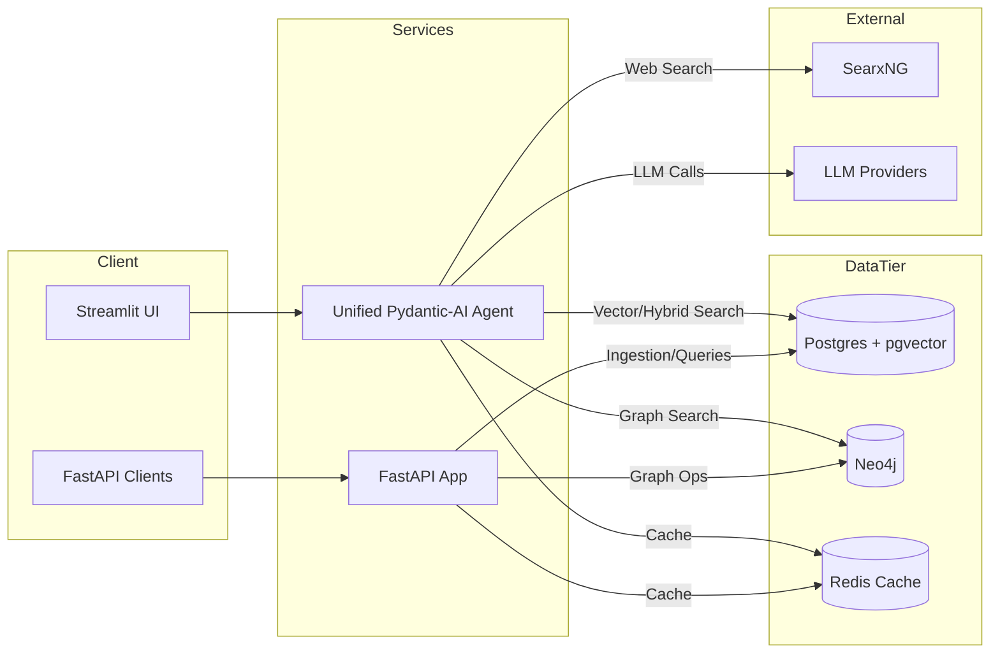
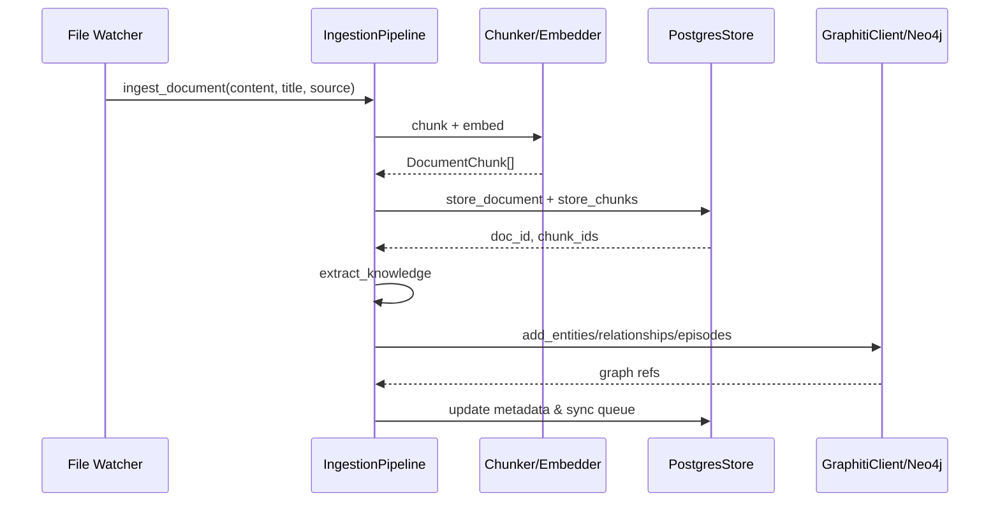
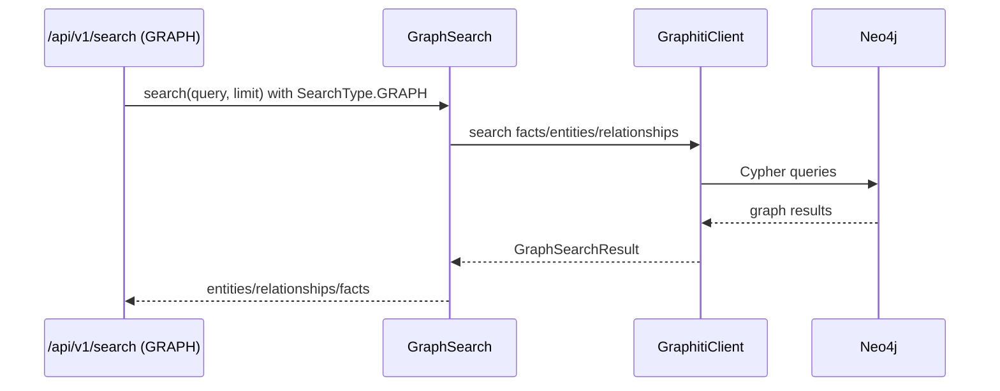
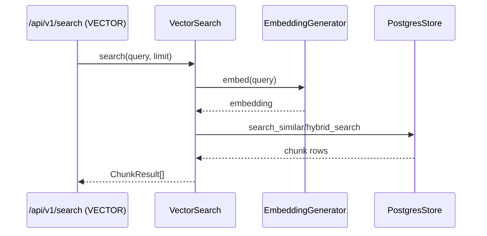
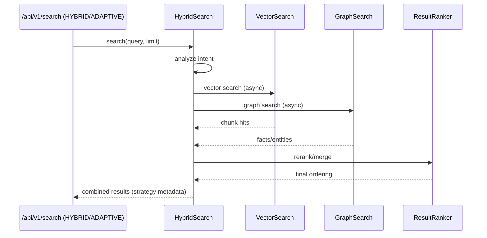
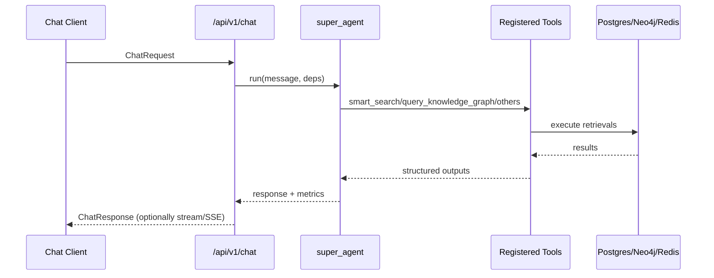

# Architecture

## System Overview
The platform exposes three surfaced experiences:
1. **Streamlit UI / Unified Agent** orchestrated via `pydantic-ai` tools, routing between hybrid search, graph queries, SQL, web search, and other tools.【F:src/agent/unified_agent.py†L27-L199】
2. **FastAPI service** exposing chat, search, documents, analytics, and health endpoints with structured middleware and metrics.【F:src/api/main.py†L1-L147】【F:src/api/endpoints/chat.py†L1-L200】【F:src/api/endpoints/search.py†L1-L208】【F:src/api/endpoints/documents.py†L1-L200】【F:src/api/endpoints/analytics.py†L1-L189】【F:src/api/health_endpoints.py†L16-L200】
3. **Background ingestion pipeline** for chunking, embedding, knowledge extraction, and persistence across Postgres and Neo4j.【F:src/agentic_rag/ingestion/pipeline.py†L1-L384】

## Component Diagram

## Deployment Topology
- **Core stack**: `app`, `searxng`, `neo4j`, `redis` services defined in Compose; Postgres is expected via Supabase connection string rather than a bundled container.【F:docker-compose.yml†L4-L158】
- **Monitoring stack**: optional Prometheus, Grafana, Jaeger, Redis exporter, Node exporter, Loki, and Promtail compose bundle for ops visibility.【F:docker-compose.monitoring.yml†L4-L165】

## Data Flow Summary
1. **Ingestion**: Local/Google Drive watchers feed `DocumentIngestionPipeline`, chunking via semantic/simple chunkers, generating embeddings, storing in Postgres, extracting knowledge, and updating Neo4j/Graphiti queue.【F:src/rag_pipeline/pipeline.py†L13-L55】【F:src/rag_pipeline/sources/local_files.py†L17-L200】【F:src/agentic_rag/ingestion/pipeline.py†L200-L384】
2. **Vector storage**: Postgres `documents`, `chunks`, `graph_sync_queue` tables with pgvector indexes and hybrid search function for retrieval.【F:src/agentic_rag/storage/migrations/sql/001_enhanced_schema.sql†L1-L200】
3. **Graph storage**: Neo4j store ensures entity/relationship management and custom indexes created by `Neo4jInitializer` with Graphiti-derived constraints.【F:src/agentic_rag/storage/neo4j_store.py†L16-L166】【F:src/agentic_rag/storage/migrations/neo4j_init.py†L17-L170】
4. **Retrieval**: Vector search, graph search, and hybrid orchestrator coordinate via connection manager, intent analyzer, and result ranker to produce aggregated answers.【F:src/agentic_rag/search/vector_search.py†L1-L200】【F:src/agentic_rag/search/graph_search.py†L1-L200】【F:src/agentic_rag/search/hybrid_search.py†L31-L194】
5. **Response synthesis**: Unified agent selects appropriate tools (smart search, graph query, SQL, etc.) and streams results over chat endpoints with SSE/WebSocket support.【F:src/agent/unified_agent.py†L139-L308】【F:src/api/endpoints/chat.py†L38-L200】

## Sequence Diagrams

### Document Ingestion

*References:* ingestion pipeline orchestrates these steps, calling chunker, embedder, Postgres store, and graph update routines.【F:src/agentic_rag/ingestion/pipeline.py†L200-L384】

### Graph Retrieval (Graph Only)

*References:* Graph search delegates to Graphiti client/Neo4j for entity/fact retrieval.【F:src/agentic_rag/search/graph_search.py†L147-L233】

### SQL Retrieval (Vector Only)

*References:* vector search generates embeddings, invokes Postgres hybrid/vector queries, and returns chunk results.【F:src/api/endpoints/search.py†L48-L120】【F:src/agentic_rag/search/vector_search.py†L165-L199】【F:src/agentic_rag/storage/postgres_store.py†L150-L236】

### Hybrid Retrieval

*References:* hybrid search analyzes intent, runs vector/graph branches, merges via ranker, and returns aggregated metadata.【F:src/agentic_rag/search/hybrid_search.py†L108-L194】

### Answer Generation (Chat)

*References:* chat endpoint invokes `super_agent` tools and returns response with metrics and sources.【F:src/api/endpoints/chat.py†L38-L200】【F:src/agent/unified_agent.py†L139-L308】
