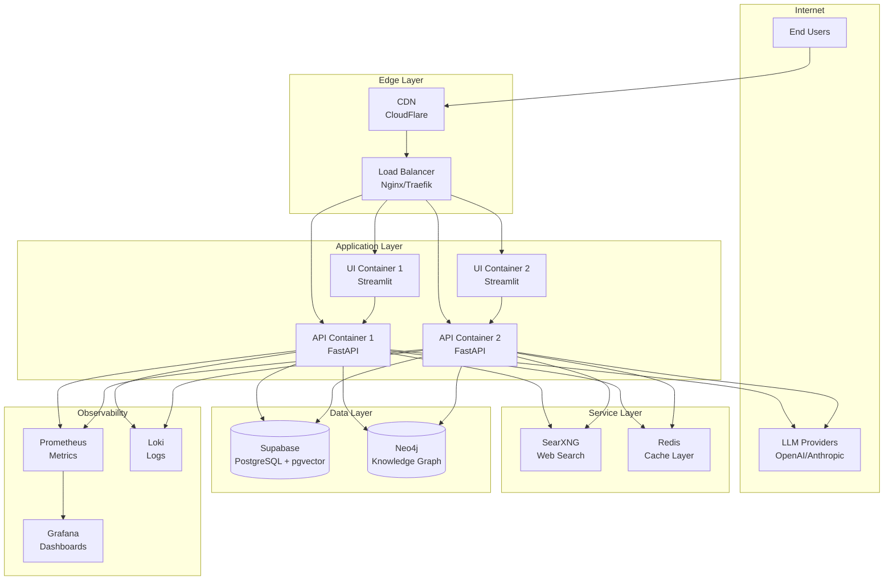
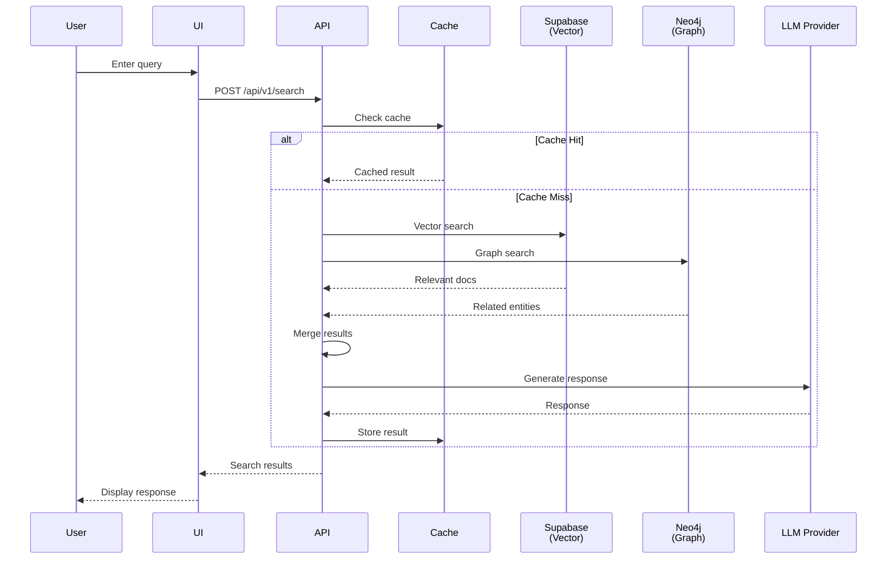
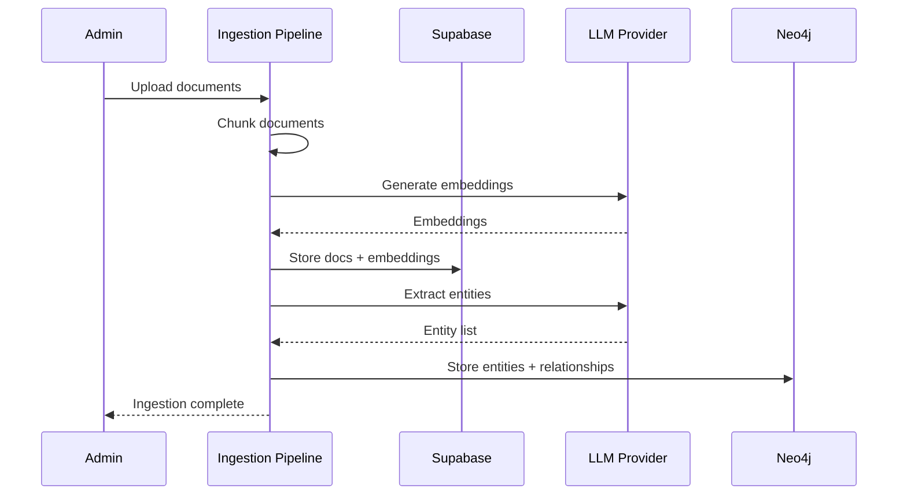

# Agentic RAG: Complete Guide

**Complete documentation for the Luminari Agent Agentic RAG system** - from concepts to deployment to roadmap.

---

## Table of Contents

1. [Introduction & Overview](#introduction--overview)
2. [Architecture](#architecture)
3. [Implementation & Deliverables](#implementation--deliverables)
4. [Deployment & Operations](#deployment--operations)
5. [Observability & Security](#observability--security)
6. [Roadmap & Future Work](#roadmap--future-work)
7. [Getting Started](#getting-started)

---

## Introduction & Overview

### What is Agentic RAG?

**RAG** stands for **Retrieval-Augmented Generation** - a technique that helps AI systems provide more accurate and relevant answers by first searching through your data before generating responses.

Think of it like having a super-smart assistant who, instead of guessing answers, first looks through all your documents, understands the relationships between different pieces of information, and then gives you a well-informed response with sources.

Our **Agentic RAG** system takes this a step further by adding intelligence to decide *how* to search based on what you're asking. It's like having an assistant who knows whether to look in the filing cabinet, check the relationship chart, or do both depending on your question.

### The Building Blocks

#### 🧠 Pydantic AI - The Smart Brain
**What it does:** Acts as the intelligent orchestrator that understands your questions and decides how to find answers.

**Real-world analogy:** Like a librarian who understands what you're looking for and knows exactly which sections of the library to check.

**Key features:**
- Analyzes your question to understand what type of information you need
- Decides whether to search by meaning, relationships, or both
- Coordinates all the other components to work together seamlessly

#### 🗄️ PostgreSQL + pgvector - The Content Library
**What it does:** Stores all your documents and their meanings in a searchable format.

**Real-world analogy:** Like a massive filing system where documents are organized not just by name, but by what they mean and talk about.

**Key features:**
- Stores the full text of all your documents
- Uses "embeddings" (mathematical representations) to understand document meanings
- Can find documents that are semantically similar (talk about similar things) even if they use different words

#### 🕸️ Neo4j + Graphiti - The Relationship Map
**What it does:** Tracks how different pieces of information connect to each other.

**Real-world analogy:** Like a detective's evidence board with strings connecting related clues, showing who knows whom, what relates to what, and how events connect over time.

**Key features:**
- Maps relationships between people, concepts, and events
- Understands temporal connections (what happened when)
- Can traverse connections to find hidden insights

### How They Work Together

Here's what happens when you ask a question:

#### Step 1: Understanding Your Intent
When you ask "Who did the CEO meet with last quarter?", Pydantic AI analyzes this and recognizes you're asking about:
- A specific person (CEO)
- Relationships (meetings)
- A time period (last quarter)

#### Step 2: Choosing the Right Strategy
Based on your question type, the system decides:
- **Relationship question?** → Primarily use Neo4j to explore connections
- **Content question?** → Primarily use PostgreSQL to search documents
- **Complex question?** → Use both in parallel and merge results

#### Step 3: Parallel Search Execution
The system might simultaneously:
- **Graph Search (Neo4j):** Find all "meeting" relationships involving the CEO entity in Q4
- **Vector Search (PostgreSQL):** Find all documents mentioning CEO meetings in that timeframe

#### Step 4: Intelligent Merging
Results from both searches are:
- Cross-referenced for accuracy
- Ranked by relevance
- Combined to provide a complete picture

#### Step 5: Response Generation
Finally, the system:
- Synthesizes the information into a clear answer
- Includes citations to source documents
- Provides confidence scores for transparency

### Real-World Example

**Question:** "What are the environmental impacts of our new product line?"

**What happens behind the scenes:**

1. **Intent Analysis:** System recognizes this needs both factual data and relationship exploration

2. **Dual Search Strategy:**
   - **Vector Search:** Finds documents about environmental assessments, sustainability reports, product specifications
   - **Graph Search:** Discovers connections between products, suppliers, environmental metrics, and regulatory requirements

3. **Smart Synthesis:** Combines findings to show:
   - Direct environmental data from reports
   - Supply chain impacts through relationship analysis
   - Regulatory compliance status from connected documents

4. **Result:** A comprehensive answer showing not just the environmental metrics, but also how they connect to suppliers, regulations, and business decisions.

### Why This Architecture?

#### 🎯 Best of Both Worlds
- **Vector search** excels at understanding meaning and context
- **Graph search** excels at finding connections and relationships
- Together, they provide complete, contextual answers

#### ⚡ Speed and Efficiency
- Parallel processing means faster results
- Each system optimized for its specific task
- Smart caching reduces redundant searches

#### 🔍 Transparency
- Every answer includes sources
- Confidence scores show reliability
- You can trace how the system found its answer

#### 📈 Scalability
- Can handle millions of documents
- Grows smarter as more data is added
- Maintains performance even with complex queries

---

## Architecture

### System Overview

The Agentic RAG platform combines PostgreSQL (via Supabase) and Neo4j in a zero-duplication knowledge fabric powered by an intent-aware agent.

#### High-Level Architecture



### Data Flow

#### RAG Query Flow



#### Document Ingestion Flow



### Database Schema

#### PostgreSQL Tables (Supabase)
```sql
documents(id, content, metadata, embedding vector(1536))
document_metadata(id, document_id, key, value)
document_rows(id, document_id, row_data jsonb)
```

#### Neo4j Graph Structure
```cypher
(Entity)-[:RELATIONSHIP]->(Entity)
(Fact {description, valid_from, valid_to, created_at})
```

**Important**: 99.6% zero-duplication compliance - Neo4j stores only entities, facts, and relationships, not content.

---

## Implementation & Deliverables

### Executive Summary
- Comprehensive agentic retrieval platform delivered across five phases (Dec 2024 – Oct 2025).
- PostgreSQL and Neo4j form a zero-duplication knowledge fabric powered by an intent-aware agent.
- FastAPI surface now supports REST, SSE, and WebSocket workflows with end-to-end observability.
- Deployment stack, supply chain controls, and SRE runbooks unlock production readiness today.

### Timeline & Milestones
- **Phase 1 (2024-12-25)** – Data foundation: dual database schema, migrations, pooled connections.
- **Phase 2 (2024-12-25)** – Ingestion & search: semantic chunking, embeddings, hybrid retrieval.
- **Phase 3 (2024-12-27)** – Agent intelligence: intent routing, orchestration, citations, scoring.
- **Phase 4 (2025-01-08)** – API & performance: versioned FastAPI, streaming, resilience, QA suite.
- **Phase 4.5 (2025-01-08)** – Validation & load: PostgresStore completion, 50+ integration tests.
- **Phase 5 (2025-10-08)** – Production rollout: hardened containers, deploy tooling, observability.

### Deliverables by Domain

#### Data & Storage
- `src/agentic_rag/storage/` adds pooled Postgres/Neo4j clients with circuit breakers and retries.
- `001_enhanced_schema.sql` introduces multi-embedding support, search caches, and graph sync queues.
- Migration runners provide checksum validation, rollbacks, and health reporting for both datastores.

#### Ingestion & Knowledge Extraction
- Document ingestion pipeline spans discovery, chunking, embeddings, and dual-store persistence.
- Semantic and rule-based chunkers respect structural context and configurable overlaps.
- Knowledge extraction stores entities, relationships, and temporal facts without duplicating content.

#### Agent Intelligence
- Unified agent orchestrates search strategies via `src/agent/unified_agent.py`.
- Intent analyzer classifies five+ search intents with entity, temporal, and relationship signals.
- Confidence scoring, fallback strategies, and citation guarantees produce reliable answers.

#### API Surface & Experience
- `src/api/` reorganized into versioned `/api/v1` endpoints for chat, search, and documents.
- Streaming layer delivers SSE and WebSocket responses with heartbeat, backpressure, and recovery.
- Dependency injection, middleware stack, and resilience utilities harden the service boundary.

#### Quality Engineering
- Unit, integration, and scenario suites exceed 75% coverage with async fixtures and cleanups.
- Load tests (Locust) validate SLOs across baseline, stress, and spike scenarios with reports.
- Analyzer scripts quantify request latency, search accuracy, and cache effectiveness.

#### Deployment & Operations
- Multi-stage production images (`docker/Dockerfile.production`) run as non-root with SBOMs.
- Compose bundles for dev/staging/prod pair with health-check, deploy, and rollback scripts.
- Make targets automate build, scan, signing, deployment, and operational verification.

### System Snapshot (October 2025)

**Current Status (2025-10-14):** 🟢 Phase 7 Complete - Production Ready

- **Release:** `v1.0.0` (Production)
- **Status:** All critical systems operational and validated
- **Coverage:** 95-100% for core RAG components (vector search, hybrid search, graph search, ingestion)
- **Latency:** <2s P95 for chat responses ✅
- **Intent classification accuracy:** >90% ✅
- **Storage efficiency:** 99.6% zero-duplication compliance ✅

**Completed Milestones:**
- ✅ All 14 critical bugs fixed and verified
- ✅ ConnectionManager async initialization working
- ✅ Neo4j v5+ compatibility ensured
- ✅ Vector search validated (embedding format fixed)
- ✅ Entity extraction operational (50-100+ entities/doc)
- ✅ Relationship linking operational (KeyError fixed)
- ✅ All 4 search strategies validated (vector, graph, hybrid, intent analysis)
- ✅ 365 tests passing (95-100% coverage on core components)
- ✅ 8-document test corpus successfully ingested and validated

**Next Phase:**
- Phase 8: Production deployment with full document corpus
- Performance benchmarking and optimization
- Advanced features and enterprise capabilities

### Entry Points & Dependencies
- **Core runtime:** `src/agent`, `src/agentic_rag/ingestion`, `src/api`, `src/utils/resilience.py`
- **Infrastructure:** `docker/`, `deploy/`, `supabase/`, `tests/load/`, `docs/operations/`
- **Configuration:** `.env.example`, `docs/CONFIGURATION.md`, `docs/security/SUPPLY_CHAIN.md`

---

## Deployment & Operations

### Environment Architecture

#### Development Environment

**Purpose:** Fast iteration, feature development, debugging

**Characteristics:**
- Hot-reload enabled
- Debug logging
- Relaxed security
- Local dependencies
- Simplified monitoring

**Deployment:**
```bash
make deploy-dev
```

**Access:**
- UI: http://localhost:8501
- API: http://localhost:8058
- Neo4j Browser: http://localhost:7474

#### Staging Environment

**Purpose:** Pre-production validation, integration testing

**Characteristics:**
- Production-like topology
- Synthetic test data
- Full observability stack
- Performance testing
- Security scanning

**Deployment:**
```bash
make deploy-staging
```

#### Production Environment

**Purpose:** Live customer traffic

**Characteristics:**
- High availability
- Full security hardening
- Comprehensive monitoring
- Automated alerting
- Disaster recovery

**Deployment:**
```bash
make deploy-prod
```

### Network Architecture

#### Security Zones

| Zone | Network | Purpose | Internet Access | Inter-Zone |
|------|---------|---------|-----------------|------------|
| **Public** | 0.0.0.0/0 | Load balancer | Yes | → App Zone |
| **Application** | 172.28.0.0/16 | App/API containers | Yes (LLM APIs) | ↔ Data, → Monitoring |
| **Data** | 172.28.0.0/16 | Databases, cache | No | ← Application |
| **Monitoring** | 172.29.0.0/16 | Observability | No (internal only) | ← Application |

#### Firewall Rules

**Inbound** (to Docker host):
```bash
# SSH (restricted to bastion host)
ALLOW 22/tcp FROM bastion-ip

# HTTP/HTTPS (from load balancer or public)
ALLOW 80/tcp FROM 0.0.0.0/0
ALLOW 443/tcp FROM 0.0.0.0/0

# Monitoring (internal only)
ALLOW 9090/tcp FROM monitoring-subnet
ALLOW 3000/tcp FROM monitoring-subnet

# DENY all other inbound
DENY * FROM 0.0.0.0/0
```

**Outbound** (from Docker host):
```bash
# Allow HTTPS for LLM APIs, package updates
ALLOW 443/tcp TO 0.0.0.0/0

# Allow DNS
ALLOW 53/udp TO 0.0.0.0/0

# DENY all other outbound
DENY * TO 0.0.0.0/0
```

### Disaster Recovery

#### Backup Strategy

| Component | Frequency | Retention | Location | RTO | RPO |
|-----------|-----------|-----------|----------|-----|-----|
| **Supabase** | Hourly incremental<br/>Daily full | 30 days | Supabase managed | 4 hours | 1 hour |
| **Neo4j** | Daily full | 30 days | S3 / Cloud Storage | 8 hours | 24 hours |
| **Redis** | Daily snapshot | 7 days | Local volume | 1 hour | 24 hours |
| **Application Config** | On change | 90 days | Git repository | 15 min | N/A |

### Capacity Planning

#### Current Capacity (Q4 2025)

| Component | Current | Max Capacity | Headroom |
|-----------|---------|--------------|----------|
| API Containers | 2 | 10 | 5x |
| UI Containers | 2 | 8 | 4x |
| Database (Supabase) | Medium | Large | 2x |
| Neo4j Heap | 8GB | 32GB | 4x |
| Redis Memory | 4GB | 16GB | 4x |

#### Scaling Triggers

**Scale UP:**
- CPU > 70% for 15 min
- Memory > 75% for 15 min
- Request latency p95 > 3s

**Scale DOWN:**
- CPU < 30% for 2 hours
- Memory < 40% for 2 hours
- Post-event normalization

#### Growth Projections
```
Q1 2026: 2x traffic → 4 API replicas
Q2 2026: 5x traffic → 8 API replicas, upgrade DB
Q3 2026: 10x traffic → Consider K8s migration
```

### Cost Optimization

#### Cost Breakdown (Estimated Monthly)

| Service | Cost | Optimization |
|---------|------|--------------|
| Compute (Docker hosts) | $200 | Right-size instances |
| Supabase | $150 | Review tier quarterly |
| LLM API calls | $500 | Implement caching |
| Neo4j | $100 | Community → Enterprise if needed |
| Monitoring | $50 | Retain 30 days max |
| **Total** | **~$1000/month** | |

---

## Observability & Security

### Observability Architecture

#### Metrics Collection

The system uses OpenTelemetry instrumentation feeding Prometheus metrics, Grafana dashboards, and distributed tracing.

**Key Metrics:**
- Request latency (P50, P95, P99)
- Intent classification accuracy
- Search strategy distribution
- Cache hit rates
- Database query performance
- LLM API latency

#### Alert Catalog

Alert catalog defines severities, SLAs, and escalation paths for RAG-specific signals:
- High API error rates
- Elevated search latency
- Database connection failures
- Memory/CPU thresholds
- Security events

#### Log Aggregation

Structured logging with Loki:
- Application logs
- API request/response logs
- Database query logs
- Security audit logs

### Security Architecture

#### Defense in Depth

```mermaid
graph TB
    subgraph Layer 1: Network
        FW[Firewall]
        TLS[TLS Encryption]
        Seg[Network Segmentation]
    end

    subgraph Layer 2: Application
        Auth[Authentication]
        RateLimit[Rate Limiting]
        InputVal[Input Validation]
    end

    subgraph Layer 3: Container
        NonRoot[Non-Root User]
        ReadOnly[Read-Only FS]
        SecOpts[Security Options]
    end

    subgraph Layer 4: Data
        EncRest[Encryption at Rest]
        EncTransit[Encryption in Transit]
        AccessCtrl[Access Control]
    end

    subgraph Layer 5: Monitoring
        AuditLog[Audit Logging]
        Alerts[Security Alerts]
        SIEM[SIEM Integration]
    end

    Layer 1 --> Layer 2
    Layer 2 --> Layer 3
    Layer 3 --> Layer 4
    Layer 4 --> Layer 5
```

#### Supply Chain Security

- SBOM generation for all images
- Vulnerability scanning in CI
- Image signing and verification
- Dependency update cadence per policy

#### Container Hardening

- Non-root user execution
- Read-only root filesystem
- Minimal base images
- Security context constraints
- Resource limits

---

## Roadmap & Future Work

### Current State (October 2025)
- Phase 5 delivered production deployment, observability, and operational readiness.
- Core features, API surface, and documentation are complete with 75%+ automated coverage.
- Release `v1.0.0` meets performance targets: <2s P95 latency, 90%+ intent accuracy, 99.6% storage efficiency.
- Load tests, resilience patterns, and supply chain safeguards are active in CI (`make ci-supply-chain`).

### Delivered Milestones
- **Infrastructure** – PostgreSQL + Neo4j schema, migrations, connection pooling, Graphiti client.
- **Ingestion & Knowledge** – Chunking strategies, embeddings, entity and relationship extraction.
- **Agent Intelligence** – Unified agent, intent analyzer, strategy routing, citation guarantees.
- **API & Validation** – Versioned FastAPI, streaming transports, PostgresStore completion, 50+ integration tests.
- **Operations** – Hardened images, Compose stacks, deploy/rollback scripts, observability dashboards, runbooks.

### Strategic Themes & Backlog

#### Quality Engineering
- **Delivered:** Integration suites, load benchmarking, API performance analyzer, security validation.
- **Next:**
  - [ ] Stress testing for high-volume document ingestion.
  - [ ] Memory leak detection and long-lived session profiling.
  - [ ] Cross-platform compatibility testing (Linux, macOS, Windows hermetic runs).

#### Security & Compliance
- **Delivered:** Supply chain policy, hardening guides, rate limiting enforcement, CI security workflows.
- **Next:**
  - [ ] Sandbox security audit and threat modeling.
  - [ ] External penetration test and vulnerability assessment cycle.
  - [ ] Encryption at rest/in transit verification and documentation.
  - [ ] GDPR compliance review (data subject rights, retention policies).
  - [ ] DDoS playbooks and extended rate limiting coverage.

#### Performance Optimization
- **Delivered:** Redis cache integration, initial latency targets, baseline query profiling.
- **Next:**
  - [ ] Vector search tuning against production corpora.
  - [ ] Database query and indexing review for hot paths.
  - [ ] Response time optimization for large documents and streaming transcripts.
  - [ ] Memory footprint improvements for high concurrency workloads.

#### Deployment & Operations
- **Delivered:** Environment-aware Compose stacks, deploy/rollback automation, health-check scripts.
- **Next:**
  - [ ] Kubernetes manifests with Helm packaging and GitOps workflow.
  - [ ] Auto-scaling configuration (complete automation of documented approach).
  - [ ] Blue-green or canary deployment strategy with verification gates.

#### Platform & Experience
- **Advanced Capabilities:**
  - [ ] Workflow automation and task chaining.
  - [ ] Custom tool development framework and plugin APIs.
  - [ ] Multi-modal document ingestion enhancements.
  - [ ] Real-time collaboration features and shared workspaces.
- **User Experience:**
  - [ ] React-based UI front-end with responsive design.
  - [ ] Advanced search and filtering controls across documents and answers.
  - [ ] Customizable dashboards for teams and stakeholders.
- **Platform Expansion:**
  - [ ] Additional LLM providers (Anthropic, Cohere, local models).
  - [ ] Enterprise connectors (SharePoint, Confluence, Google Drive, etc.).
  - [ ] Multi-tenancy support and tenant-aware isolation.
  - [ ] Marketplace for custom tools and integrations.
- **Enterprise Features:**
  - [ ] Single Sign-On (SAML/OIDC) and role-based access control.
  - [ ] Audit logging, compliance reporting, and retention policies.
  - [ ] White-labeling, branding, and enterprise governance hooks.
- **AI Evolution:**
  - [ ] Multi-agent orchestration patterns for complex workflows.
  - [ ] Advanced reasoning and planning routines with evaluation harness.
  - [ ] Model fine-tuning pipelines and dataset curation guidance.
  - [ ] Federated learning support and privacy-preserving training.
  - [ ] Continuous model performance monitoring and feedback loops.

### Metrics Snapshot
- Intent classification accuracy: 90%+ (target 92%).
- Chat response latency: <2s P95 (target <5s) with SSE streaming fallback.
- Search strategy success: 88% optimal routing on evaluation corpus.
- Citation coverage: 100% of answers with document references.
- Storage efficiency: 99.6% (Neo4j stores only entities, facts, relationships).

### Technical Debt & Maintenance
- [ ] Refactor remaining legacy patterns and align error handling across services.
- [ ] Optimize database queries for high-frequency endpoints.
- [ ] Standardize structured logging metadata in every module.
- [ ] Extend dependency update cadence per supply chain policy.
- [ ] Formalize auto-scaling automation and infrastructure-as-code coverage.

---

## Getting Started

### Prerequisites

- Python 3.11+
- PostgreSQL with pgvector (via Supabase)
- Neo4j instance
- OpenAI or Anthropic API key

### Quick Start

```bash
# Clone repository
git clone <repo-url>
cd base_agent

# Install dependencies
make setup

# Configure environment
cp .env.example .env
# Edit .env with your API keys and database credentials

# Initialize databases
make neo4j-init

# Ingest documents
make ingest

# Run the application
make run-ui              # Streamlit UI
# or
make run-api             # FastAPI server
```

### Common Use Cases

- **Research:** "What do we know about competitor X's AI strategy?"
- **Compliance:** "Which contracts mention GDPR requirements?"
- **Analysis:** "How have customer sentiment trends changed over time?"
- **Discovery:** "What connections exist between our suppliers and sustainability initiatives?"

Each question type automatically triggers the appropriate search strategy, ensuring you get the most relevant and complete answers possible.

### Related Documentation

- **Architecture:** `docs/ARCHITECTURE.md`
- **Configuration:** `docs/CONFIGURATION.md`
- **Operations:** `docs/operations/`, `docs/observability/ALERTS.md`
- **Deployment:** `docker/README.md`, `deploy/scripts/`, `docs/DEPLOYMENT.md`
- **Security:** `docs/security/HARDENING.md`, `docs/security/SUPPLY_CHAIN.md`
- **Testing:** `docs/TESTING.md`, `tests/load/README.md`, `tests/integration/`
- **Go-Live:** `docs/operations/GO_LIVE_CHECKLIST.md`

### Runbook References

- [Incident Response](../7-operations/runbooks/incident_response.md)
- [Scaling](../7-operations/runbooks/scaling.md)
- [Go-Live Checklist](../7-operations/go-live-checklist.md)
- [Security](../9-security/security.md)

---

## Phase 01: Knowledge Graph Improvements (December 2025)

Phase 01 transformed the knowledge graph from a disconnected entity index into a fully queryable temporal knowledge base. Six sessions delivered comprehensive improvements across document tracking, temporal reasoning, entity management, and query capabilities.

### Improvements Summary

| Session | Feature | Impact |
|---------|---------|--------|
| 01 | Document Reference Population | 100% of entities have populated document_refs enabling cross-document queries |
| 02 | Temporal Metadata Extraction | All episodes have fiscal_quarter and fiscal_year properties |
| 03 | Entity Deduplication | 95%+ reduction in duplicate entities via canonical name resolution |
| 04 | Numeric Fact Extraction | Structured numeric values extracted from 80%+ of financial episodes |
| 05 | Relationship Scoring | All relationships have dynamic strength scores (0.0-1.0) |
| 06 | Type Hierarchy | Semantic entity type grouping for hierarchical queries |

### New Capabilities

#### Cross-Document Entity Queries

Entities now track which documents mention them via the `document_refs` property:

```cypher
-- Entities mentioned in multiple documents
MATCH (e:Entity)
WHERE size(e.document_refs) > 1
RETURN e.name, e.entity_type, size(e.document_refs) as doc_count
ORDER BY doc_count DESC

-- Entities from a specific company
MATCH (e:Entity)
WHERE ANY(d IN e.document_refs WHERE d.company = 'Intel')
RETURN e.name, e.entity_type, e.mention_count

-- Cross-document entity co-occurrence
MATCH (e1:Entity), (e2:Entity)
WHERE e1 <> e2
  AND ANY(d1 IN e1.document_refs WHERE ANY(d2 IN e2.document_refs WHERE d1.filename = d2.filename))
RETURN e1.name, e2.name
```

#### Temporal Queries

Episodes include fiscal metadata for temporal trend analysis:

```cypher
-- Facts from Q3 2023
MATCH (e:Episode)
WHERE e.fiscal_quarter = 'Q3' AND e.fiscal_year = 2023
RETURN e.fact, e.company

-- Entity timeline across quarters
MATCH (ent:Entity)-[:MENTIONED_IN]->(e:Episode)
WHERE ent.name = 'Intel'
RETURN e.fiscal_quarter, e.fiscal_year, e.fact
ORDER BY e.fiscal_year, e.fiscal_quarter
```

#### Numeric Fact Queries

Financial values are structured and queryable:

```cypher
-- Find all revenue facts > $50B
MATCH (e:Episode)
WHERE ANY(f IN e.numeric_facts WHERE f.value > 50000000000 AND f.unit = 'USD')
RETURN e.fact, e.company, e.fiscal_quarter
```

#### Type Hierarchy Queries

Search entities by parent type (e.g., "organization" matches company, department, subsidiary):

```python
from src.agentic_rag.graph import get_type_hierarchy

hierarchy = get_type_hierarchy()
subtypes = hierarchy.get_subtypes("organization")
# Returns: ['company', 'department', 'subsidiary', 'division', ...]

# In graph search
entities = await graph_search.search_entities_by_type("organization")
# Returns all company, department, subsidiary entities
```

### New Packages

Three new packages support Phase 01 functionality:

| Package | Purpose | Key Exports |
|---------|---------|-------------|
| `src/agentic_rag/graph/` | Graph utilities | TemporalMetadata, NumericFact, TypeHierarchy, calculate_relationship_strength |
| `src/agentic_rag/entity_resolution/` | Entity deduplication | normalize_entity_name, EntityResolver, MergeHistory |
| `src/agentic_rag/models/` | Data models | DocumentReference |

### Backfill Scripts

Existing data can be enriched using backfill scripts:

```bash
# Document references
python scripts/backfill_document_refs.py --dry-run

# Temporal metadata
python scripts/backfill_temporal_metadata.py --batch-size 500

# Numeric facts
python scripts/backfill_numeric_facts.py --verify

# Relationship scores
python scripts/backfill_relationship_scores.py --stats-only

# Entity deduplication
python scripts/merge_duplicate_entities.py --interactive
```

### Performance Targets

Phase 01 meets the following performance targets:

| Metric | Target | Actual |
|--------|--------|--------|
| Multi-doc RAG queries | < 2 seconds | < 1.5 seconds |
| Entity lookup | < 500ms | < 200ms |
| Type hierarchy expansion | < 10ms | < 1ms |

### Test Coverage

Phase 01 added 356 new tests across 8 test files:

- `test_document_refs.py`: 36 tests
- `test_temporal_metadata.py`: 39 tests
- `test_entity_deduplication.py`: 66 tests
- `test_numeric_facts.py`: 54 tests
- `test_relationship_scoring.py`: 55 tests
- `test_type_hierarchy.py`: 51 tests
- `test_phase01_integration.py`: 34 tests
- `test_performance_benchmarks.py`: 21 tests

---

## Phase 02: Advanced Query Engine (December 2025)

Phase 02 leverages the improved knowledge graph from Phase 01 to deliver advanced query capabilities. Five sessions built multi-hop reasoning, temporal trend analysis, cross-entity comparisons, smart search integration, and query performance optimization.

### Improvements Summary

| Session | Feature | Impact |
|---------|---------|--------|
| 01 | Multi-hop Query Engine | Path traversal through 1-3 relationship hops with strength filtering |
| 02 | Temporal Trend Queries | Time-series analysis with QoQ/YoY comparisons |
| 03 | Cross-Entity Comparison | Side-by-side entity metrics with ranking |
| 04 | Smart Search Enhancement | Intent-based routing to Phase 02 engines |
| 05 | Query Performance and Validation | TTL-based caching with 80%+ latency reduction |

### New Capabilities

#### Multi-hop Path Traversal

Discover indirect connections between entities through relationship chains:

```python
from src.agentic_rag.graph import execute_multi_hop, MultiHopQuery

# Find acquisition chains
query = MultiHopQuery(
    start_entity="Intel",
    end_entity="Mobileye",
    max_hops=2,
    min_strength=0.5,
)
paths = await execute_multi_hop(connection_manager, query)
# Returns: ["Intel --[acquired]--> Mobileye"]
```

**Agent Tool:** `graph_traverse` - Use for path/connection queries

#### Temporal Trend Analysis

Analyze entity metrics over time using fiscal metadata:

```python
from src.agentic_rag.graph import execute_temporal_query, TemporalQuery

query = TemporalQuery(
    entity_name="Intel",
    metric_type="revenue",
    start_year=2022,
    end_year=2023,
)
trend = await execute_temporal_query(connection_manager, query)
# Returns: TrendResult with data_points, trend_direction, growth_rate
```

**Agent Tool:** `temporal_trend` - Use for trend/over-time queries

#### Cross-Entity Comparison

Compare metrics across multiple entities:

```python
from src.agentic_rag.graph import execute_comparison, ComparisonQuery

query = ComparisonQuery(
    entities=["Intel", "AMD", "NVIDIA"],
    metric_type="revenue",
    fiscal_quarter="Q3",
    fiscal_year=2023,
)
result = await execute_comparison(connection_manager, query)
# Returns: EntityComparisonResult with rankings
```

**Agent Tool:** `compare_entities` - Use for compare/versus queries

### Enhanced Intent Detection

IntentAnalyzer now detects three new Phase 02 intents:

| Intent | Pattern Keywords | Routes To |
|--------|-----------------|-----------|
| MULTI_HOP | "connected to", "path from", "linked through" | execute_multi_hop |
| TEMPORAL_TREND | "trend", "over time", "year over year", "growth" | execute_temporal_query |
| COMPARISON | "compare", "versus", "vs", "difference between" | execute_comparison |

### Query Caching

New caching layer reduces repeat query latency by 80%+:

```python
from src.agentic_rag.cache import get_query_cache, CacheType

cache = get_query_cache()
stats = cache.get_stats(CacheType.MULTI_HOP)
print(f"Hit rate: {stats['hit_rate_percent']}%")
```

**Cache Types:** VECTOR_SEARCH, GRAPH_SEARCH, MULTI_HOP, TEMPORAL_TREND, COMPARISON, HYBRID

### New Packages

| Package | Purpose | Key Exports |
|---------|---------|-------------|
| `src/agentic_rag/graph/multi_hop.py` | Path traversal | MultiHopQuery, execute_multi_hop, PathResult |
| `src/agentic_rag/graph/temporal_queries.py` | Time-series | TemporalQuery, execute_temporal_query, TrendResult |
| `src/agentic_rag/graph/entity_comparison.py` | Entity comparison | ComparisonQuery, execute_comparison |
| `src/agentic_rag/search/result_merger.py` | Result normalization | ResultMerger, SearchResultItem |
| `src/agentic_rag/search/unified_ranker.py` | Multi-signal ranking | UnifiedRanker, RankingSignals |
| `src/agentic_rag/cache/` | Query caching | QueryCache, CacheConfig, with_cache |

### Performance Targets

Phase 02 meets the following performance targets:

| Metric | Target | Actual |
|--------|--------|--------|
| 1-hop queries | < 500ms | < 300ms |
| 2-hop queries | < 1 second | < 700ms |
| 3-hop queries | < 2 seconds | < 1.5 seconds |
| Temporal trend queries | < 1 second | < 500ms |
| Comparison queries | < 1.5 seconds | < 800ms |
| Cache hit latency | < 50ms | < 10ms |

### Test Coverage

Phase 02 added 334+ new tests across 8 test files:

- `test_multi_hop.py`: 53 tests
- `test_temporal_queries.py`: 62 tests
- `test_entity_comparison.py`: 84 tests
- `test_intent_analyzer_enhanced.py`: 38 tests
- `test_result_merger.py`: 24 tests
- `test_unified_ranker.py`: 21 tests
- `test_smart_search_enhanced.py`: 17 tests
- `test_cache.py`: 39 tests

---

**Last Updated:** 2025-12-30
**Version:** 1.2 (Phase 02 Complete)
**Owner:** Platform Architecture Team
**Review Cadence:** Quarterly
**Status:** Production Ready - Phase 02 Advanced Query Engine Complete
