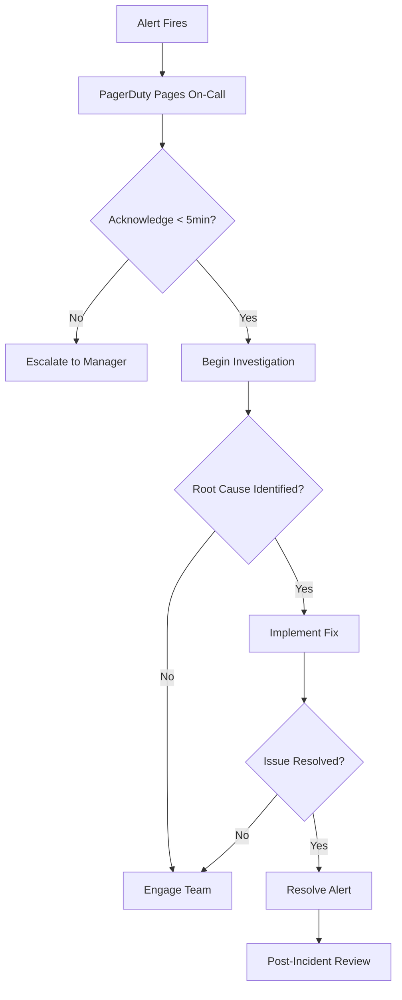

# Alerting Documentation

## Overview

This document describes the alerting strategy, alert definitions, severity levels, and response procedures for the Base Agent / Agentic RAG platform.

## Alert Severity Levels

| Severity | Description | Response Time | Notification Channel | Example |
|----------|-------------|---------------|---------------------|---------|
| **Critical** | Service-impacting issue requiring immediate action | < 15 minutes | PagerDuty (page on-call) | Service down, critical errors >5% |
| **High** | Significant degradation, page during business hours | < 1 hour | PagerDuty (business hours), Slack | High latency, LLM provider errors |
| **Medium** | Performance degradation, investigate within SLA | < 4 hours | Slack, Email | Slow queries, high memory usage |
| **Low** | Informational, investigate during maintenance | < 24 hours | Email | Container restarts, high request volume |

## Alert Categories

### 1. Infrastructure Alerts

#### ServiceDown
- **Severity**: Critical
- **Condition**: Service unreachable for > 1 minute
- **Impact**: Complete service outage
- **Response**:
  1. Check service logs: `make logs-app` or `make logs-api`
  2. Verify container status: `docker ps -a`
  3. Check recent deployments
  4. Initiate rollback if needed: `make rollback-prod`

#### MemoryUsageCritical
- **Severity**: Critical
- **Condition**: Memory usage > 90% for 5 minutes
- **Impact**: Risk of OOM kills
- **Response**:
  1. Identify memory-consuming processes
  2. Check for memory leaks in application logs
  3. Scale horizontally if possible
  4. Restart service if memory leak confirmed

#### DiskSpaceCritical
- **Severity**: Critical
- **Condition**: Disk space < 10%
- **Impact**: Service failures, data loss risk
- **Response**:
  1. Identify large files/directories: `du -sh /* | sort -h`
  2. Clean up old logs: `make image-clean`
  3. Archive or delete old backups
  4. Scale storage if consistently high usage

### 2. API Performance Alerts

#### HighErrorRate
- **Severity**: Critical
- **Condition**: 5xx error rate > 5% for 5 minutes
- **Impact**: User-facing failures
- **Response**:
  1. Check application logs for error patterns
  2. Verify database connectivity
  3. Check LLM provider status
  4. Review recent code changes
  5. Consider rollback if errors started after deployment

#### HighLatency
- **Severity**: High
- **Condition**: p95 latency > 2 seconds for 10 minutes
- **Impact**: Poor user experience
- **Response**:
  1. Check distributed tracing for slow spans
  2. Review database query performance
  3. Check LLM response times
  4. Verify network connectivity
  5. Scale if needed

### 3. Database Alerts

#### DatabaseConnectionFailure
- **Severity**: Critical
- **Condition**: > 10 connection failures in 2 minutes
- **Impact**: Service degradation or outage
- **Response**:
  1. Verify Supabase/PostgreSQL status
  2. Check connection pool settings
  3. Review database logs
  4. Verify network connectivity
  5. Restart database connection pool

#### SlowDatabaseQueries
- **Severity**: Medium
- **Condition**: p95 query time > 1 second for 10 minutes
- **Impact**: Increased latency
- **Response**:
  1. Identify slow queries using database logs
  2. Check for missing indexes
  3. Review query execution plans
  4. Consider query optimization or caching

#### Neo4jConnectionIssues
- **Severity**: High
- **Condition**: No idle Neo4j connections for 5 minutes
- **Impact**: Graph search failures
- **Response**:
  1. Check Neo4j service status
  2. Review connection pool configuration
  3. Verify network connectivity
  4. Check for long-running queries
  5. Restart Neo4j if needed

### 4. RAG-Specific Alerts

#### DocumentIngestionFailing
- **Severity**: High
- **Condition**: > 0.1 ingestion failures/sec for 5 minutes
- **Impact**: New documents not being indexed
- **Response**:
  1. Check ingestion pipeline logs
  2. Verify Supabase and Neo4j connectivity
  3. Check for malformed documents
  4. Review embedding provider status
  5. Verify storage capacity

#### VectorSearchSlow
- **Severity**: Medium
- **Condition**: p95 vector search > 3 seconds for 10 minutes
- **Impact**: Slow RAG responses
- **Response**:
  1. Check pgvector index health
  2. Verify database performance
  3. Review embedding dimensionality
  4. Consider index optimization

#### GraphSearchFailing
- **Severity**: High
- **Condition**: > 5% graph search failures for 5 minutes
- **Impact**: Incomplete RAG results
- **Response**:
  1. Check Neo4j service health
  2. Review Cypher query logs
  3. Verify Graphiti integration
  4. Check for schema changes

#### LowRetrievalQuality
- **Severity**: Medium
- **Condition**: Average relevance score < 0.6 for 15 minutes
- **Impact**: Poor search results
- **Response**:
  1. Review embedding model performance
  2. Check document quality
  3. Analyze query patterns
  4. Consider reindexing with improved chunking

### 5. LLM Provider Alerts

#### LLMProviderErrors
- **Severity**: High
- **Condition**: > 0.1 LLM failures/sec for 5 minutes
- **Impact**: Degraded agent responses
- **Response**:
  1. Check LLM provider status page
  2. Verify API key validity
  3. Review rate limits
  4. Consider fallback to alternative provider
  5. Check for malformed prompts

### 6. Cache Alerts

#### RedisConnectionFailures
- **Severity**: High
- **Condition**: Redis connection errors detected
- **Impact**: Degraded performance, no caching
- **Response**:
  1. Check Redis service status
  2. Verify network connectivity
  3. Review Redis logs
  4. Restart Redis if needed

#### CacheHitRateLow
- **Severity**: Medium
- **Condition**: Cache hit rate < 50% for 30 minutes
- **Impact**: Increased load on backend services
- **Response**:
  1. Review cache key patterns
  2. Analyze query diversity
  3. Adjust TTL settings
  4. Consider cache warming strategies

## Alert Response Workflow

### Critical Alerts

### High/Medium Alerts

1. **Acknowledge**: Confirm receipt within SLA
2. **Investigate**: Use runbooks and dashboards
3. **Mitigate**: Apply temporary fix if needed
4. **Resolve**: Implement permanent solution
5. **Document**: Update runbook with learnings

## Alert Tuning

### Reducing Alert Fatigue

- **Review weekly**: Alert frequency and actionability
- **Adjust thresholds**: Based on baseline metrics
- **Consolidate**: Group related alerts
- **Silence**: Known issues during maintenance windows

### Adding New Alerts

1. Define clear trigger condition
2. Assign appropriate severity
3. Document response procedure
4. Add to Prometheus alert rules
5. Test alert with simulation
6. Update this documentation

## Integration with Monitoring Tools

### Prometheus
- Alert definitions: `deploy/config/prometheus-alerts.yml`
- Evaluation interval: 30s
- For operator: Manages alerting rules

### Grafana
- Dashboard: "Base Agent - Alerts"
- Alert visualization
- Annotation of deployment events

### PagerDuty
- Integration key: Stored in secrets
- Routing rules by severity
- Escalation policy: On-call rotation

### Slack
- Channel: `#base-agent-alerts`
- Medium/Low severity notifications
- Alert thread discussions

## Metrics Reference

All metrics are exposed at `/metrics` endpoint.

### Core Metrics

| Metric | Type | Description |
|--------|------|-------------|
| `http_requests_total` | Counter | Total HTTP requests by status |
| `http_request_duration_seconds` | Histogram | Request duration distribution |
| `llm_requests_total` | Counter | Total LLM API calls |
| `llm_requests_failed_total` | Counter | Failed LLM requests |
| `vector_search_duration_seconds` | Histogram | Vector search latency |
| `graph_search_duration_seconds` | Histogram | Graph search latency |
| `cache_hits_total` | Counter | Cache hits |
| `cache_misses_total` | Counter | Cache misses |
| `db_connections_active` | Gauge | Active database connections |
| `document_ingestion_failures_total` | Counter | Document ingestion failures |

## Runbook Links

- [Incident Response Runbook](../runbooks/incident_response.md)
- [Scaling Runbook](../runbooks/scaling.md)

<!-- TODO: Add when runbooks are created:
- Database Issues Runbook (../runbooks/database_issues.md)
- Deployment Runbook (../runbooks/deployment.md)
-->

## Contact Information

- **On-Call Rotation**: PagerDuty schedule
- **Platform Team**: platform-team@example.com
- **Security Team**: security@example.com
- **Escalation Manager**: manager@example.com

---

**Last Updated**: 2025-10-08
**Owner**: Platform SRE Team
**Review Cadence**: Monthly
