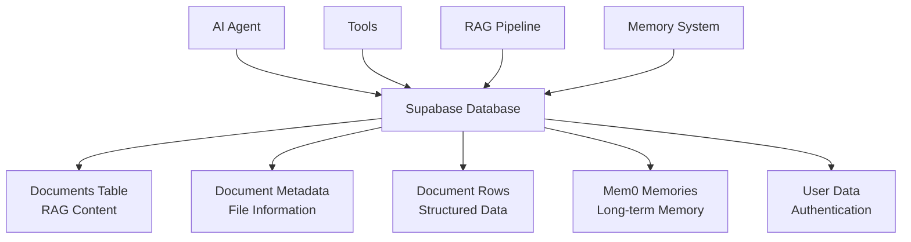

# Database & RAG System Documentation

This document provides comprehensive documentation for the Luminari AI Agent's database architecture and RAG (Retrieval-Augmented Generation) system.

## 🏗️ Architecture Overview

The system uses **Supabase** as the single database platform, providing a unified solution for all data storage needs including documents, vectors, user data, and long-term memory.



## 📊 Database Schema

### Core Tables

#### 1. `documents`
Stores chunked document content with vector embeddings for RAG.

```sql
CREATE TABLE documents (
    id BIGSERIAL PRIMARY KEY,
    content TEXT NOT NULL,
    embedding VECTOR(1536),  -- pgvector for OpenAI embeddings
    metadata JSONB,
    source TEXT,
    created_at TIMESTAMPTZ DEFAULT NOW()
);

-- Index for vector similarity search
CREATE INDEX ON documents USING ivfflat (embedding vector_cosine_ops);
```

**Metadata Structure:**
```json
{
    "file_id": "unique_file_identifier",
    "file_title": "Document Title",
    "file_url": "https://example.com/document.pdf",
    "file_type": "pdf",
    "chunk_index": 0,
    "total_chunks": 10,
    "file_contents": "base64_encoded_content",  // For images
    "mime_type": "application/pdf"
}
```

#### 2. `document_metadata`
Stores high-level information about uploaded documents.

```sql
CREATE TABLE document_metadata (
    id TEXT PRIMARY KEY,
    title TEXT NOT NULL,
    url TEXT,
    schema JSONB,  -- For structured data files
    file_type TEXT,
    upload_date TIMESTAMPTZ DEFAULT NOW(),
    status TEXT DEFAULT 'processed'
);
```

#### 3. `document_rows`
Stores structured data from spreadsheets and databases.

```sql
CREATE TABLE document_rows (
    id BIGSERIAL PRIMARY KEY,
    dataset_id TEXT REFERENCES document_metadata(id),
    row_data JSONB NOT NULL,  -- Flexible schema per file
    row_index INTEGER,
    created_at TIMESTAMPTZ DEFAULT NOW()
);

-- Index for efficient querying of row data
CREATE INDEX ON document_rows USING GIN (row_data);
```

#### 4. `mem0_memories`
Managed by Mem0 for long-term memory storage.

```sql
CREATE TABLE mem0_memories (
    id TEXT PRIMARY KEY,
    user_id TEXT NOT NULL,
    content TEXT NOT NULL,
    embedding VECTOR(1536),
    metadata JSONB,
    created_at TIMESTAMPTZ DEFAULT NOW(),
    updated_at TIMESTAMPTZ DEFAULT NOW()
);
```

### Database Functions

#### Vector Search Function
```sql
CREATE OR REPLACE FUNCTION match_documents(
    query_embedding VECTOR(1536),
    match_count INT DEFAULT 5,
    filter JSONB DEFAULT '{}'
)
RETURNS TABLE (
    id BIGINT,
    content TEXT,
    metadata JSONB,
    similarity FLOAT
)
LANGUAGE plpgsql
AS $$
BEGIN
    RETURN QUERY
    SELECT 
        documents.id,
        documents.content,
        documents.metadata,
        1 - (documents.embedding <=> query_embedding) AS similarity
    FROM documents
    WHERE (filter = '{}' OR documents.metadata @> filter)
    ORDER BY documents.embedding <=> query_embedding
    LIMIT match_count;
END;
$$;
```

#### SQL Execution Function
```sql
CREATE OR REPLACE FUNCTION execute_custom_sql(sql_query TEXT)
RETURNS JSONB
LANGUAGE plpgsql
SECURITY DEFINER
AS $$
DECLARE
    result JSONB;
BEGIN
    -- Security: Only allow SELECT statements
    IF sql_query !~* '^\s*SELECT' THEN
        RETURN jsonb_build_object('error', 'Only SELECT statements are allowed');
    END IF;
    
    -- Execute the query and return results as JSONB
    EXECUTE 'SELECT array_to_json(array_agg(row_to_json(t))) FROM (' || sql_query || ') t'
    INTO result;
    
    RETURN COALESCE(result, '[]'::jsonb);
EXCEPTION
    WHEN OTHERS THEN
        RETURN jsonb_build_object('error', SQLERRM);
END;
$$;
```

## 🔧 RAG System Implementation

### Document Processing Pipeline

1. **File Upload** → Extract text/data
2. **Text Chunking** → Split into manageable pieces
3. **Embedding Generation** → Create vector representations
4. **Database Storage** → Store chunks with embeddings
5. **Metadata Indexing** → Enable fast retrieval

### RAG Tools

#### 1. Document Retrieval
```python
async def retrieve_relevant_documents_tool(
    supabase: Client, 
    embedding_client: AsyncOpenAI, 
    user_query: str
) -> str:
    """Retrieve relevant document chunks using vector similarity."""
    
    # Generate query embedding
    query_embedding = await get_embedding(user_query, embedding_client)
    
    # Search for similar documents
    result = supabase.rpc(
        'match_documents',
        {
            'query_embedding': query_embedding,
            'match_count': 4
        }
    ).execute()
    
    return format_search_results(result.data)
```

#### 2. Document Listing
```python
async def list_documents_tool(supabase: Client) -> List[str]:
    """List all available documents with metadata."""
    
    result = supabase.from_('document_metadata') \
        .select('id, title, schema, url') \
        .execute()
    
    return result.data
```

#### 3. Full Document Content
```python
async def get_document_content_tool(
    supabase: Client, 
    document_id: str
) -> str:
    """Retrieve complete document content by combining chunks."""
    
    result = supabase.from_('documents') \
        .select('content, metadata') \
        .eq('metadata->>file_id', document_id) \
        .order('id') \
        .execute()
    
    return combine_document_chunks(result.data)
```

#### 4. SQL Query Execution
```python
async def execute_sql_query_tool(
    supabase: Client, 
    sql_query: str
) -> str:
    """Execute read-only SQL queries on structured data."""
    
    # Security validation
    if not is_read_only_query(sql_query):
        return "Error: Only SELECT statements allowed"
    
    result = supabase.rpc(
        'execute_custom_sql',
        {"sql_query": sql_query}
    ).execute()
    
    return format_sql_results(result.data)
```

## 🧠 Memory System (Mem0 Integration)

### Configuration
```python
def get_mem0_config():
    return {
        "llm": {
            "provider": "openai",
            "config": {
                "model": "gpt-4o-mini",
                "temperature": 0.2
            }
        },
        "embedder": {
            "provider": "openai", 
            "config": {
                "model": "text-embedding-3-small",
                "embedding_dims": 1536
            }
        },
        "vector_store": {
            "provider": "supabase",
            "config": {
                "connection_string": os.environ.get('SUPABASE_URL'),
                "collection_name": "mem0_memories",
                "embedding_model_dims": 1536
            }
        }
    }
```

### Usage Examples
```python
# Initialize memory client
memory = await get_mem0_client_async()

# Add memory
await memory.add(
    "User prefers technical documentation with code examples",
    user_id="user_123"
)

# Search memories
memories = await memory.search(
    "What does the user prefer?",
    user_id="user_123"
)

# Get all memories
all_memories = await memory.get_all(user_id="user_123")
```

## 🚀 Getting Started

### 1. Supabase Setup

1. **Create Supabase Project**
   ```bash
   # Visit https://supabase.com/dashboard
   # Create new project
   # Copy URL and Service Role Key
   ```

2. **Enable pgvector Extension**
   ```sql
   -- In Supabase SQL Editor
   CREATE EXTENSION IF NOT EXISTS vector;
   ```

3. **Run Schema Setup**
   ```bash
   # Upload SQL files from sql/ directory to Supabase
   # Or run them manually in SQL Editor
   ```

### 2. Environment Configuration

```bash
# Copy and configure environment
cp .env.example .env

# Set your Supabase credentials
SUPABASE_URL=https://your-project.supabase.co
SUPABASE_SERVICE_KEY=your_service_role_key
DATABASE_URL=${SUPABASE_URL}  # Points to same Supabase instance
```

### 3. Application Startup

```bash
# Install dependencies
make setup

# Run the application
make run-ui
```

## 📈 Performance Considerations

### Vector Search Optimization

1. **Index Configuration**
   ```sql
   -- Tune ivfflat index for your data size
   CREATE INDEX ON documents 
   USING ivfflat (embedding vector_cosine_ops)
   WITH (lists = 100);  -- Adjust based on document count
   ```

2. **Query Optimization**
   ```python
   # Limit result size for performance
   result = supabase.rpc(
       'match_documents',
       {
           'query_embedding': embedding,
           'match_count': 5,  # Don't go too high
           'filter': {'file_type': 'pdf'}  # Use filters when possible
       }
   )
   ```

### Embedding Strategy

- **Chunk Size**: 500-1500 characters for optimal balance
- **Overlap**: 100-200 characters between chunks
- **Batch Processing**: Generate embeddings in batches of 100

### Memory Management

- **Regular Cleanup**: Archive old memories periodically
- **User Isolation**: Always filter by user_id
- **Relevance Threshold**: Filter memories by similarity score

## 🔍 Monitoring & Debugging

### Query Performance
```sql
-- Check slow queries
SELECT query, mean_exec_time, calls 
FROM pg_stat_statements 
WHERE mean_exec_time > 1000
ORDER BY mean_exec_time DESC;
```

### Vector Search Analytics
```sql
-- Analyze search patterns
SELECT 
    metadata->>'file_type' as file_type,
    COUNT(*) as search_hits
FROM documents 
WHERE created_at > NOW() - INTERVAL '7 days'
GROUP BY metadata->>'file_type';
```

### Memory Usage
```sql
-- Check memory system usage
SELECT 
    user_id,
    COUNT(*) as memory_count,
    MAX(created_at) as last_memory
FROM mem0_memories 
GROUP BY user_id
ORDER BY memory_count DESC;
```

## 🛡️ Security & Best Practices

### Database Security
- ✅ Use Service Role Key for server-side operations only
- ✅ Implement Row Level Security (RLS) for user data
- ✅ Validate all SQL queries before execution
- ✅ Use parameterized queries to prevent injection

### API Security
- ✅ Rate limit embedding generation
- ✅ Validate file uploads before processing
- ✅ Sanitize user inputs
- ✅ Monitor for unusual query patterns

### Data Privacy
- ✅ Isolate user data by user_id
- ✅ Implement data retention policies
- ✅ Encrypt sensitive data in metadata
- ✅ Provide data export/deletion capabilities

## 📚 Additional Resources

- [Supabase Documentation](https://supabase.com/docs)
- [pgvector Documentation](https://github.com/pgvector/pgvector)
- [Mem0 Documentation](https://docs.mem0.ai/)
- [OpenAI Embeddings Guide](https://platform.openai.com/docs/guides/embeddings)

---

*Last Updated: August 20, 2025*
*For questions or issues, please refer to the project repository or create an issue.*
