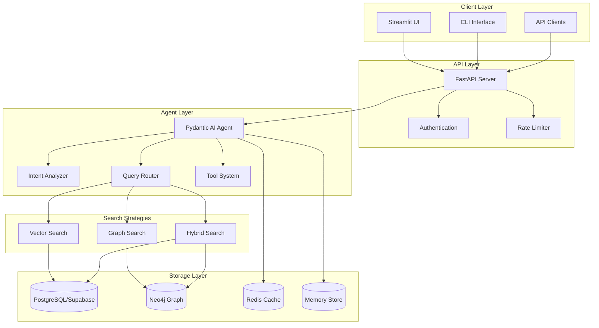
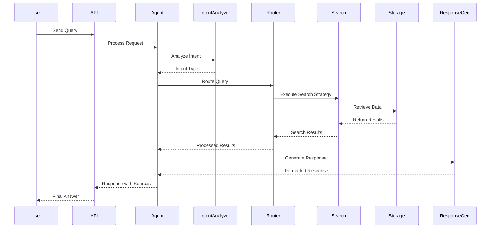
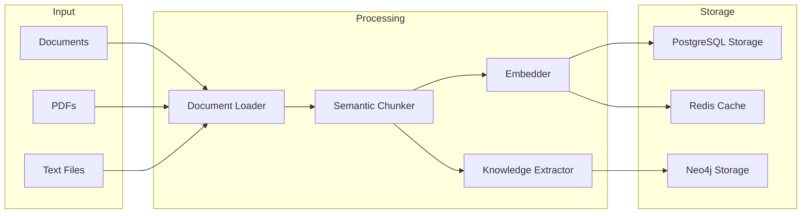
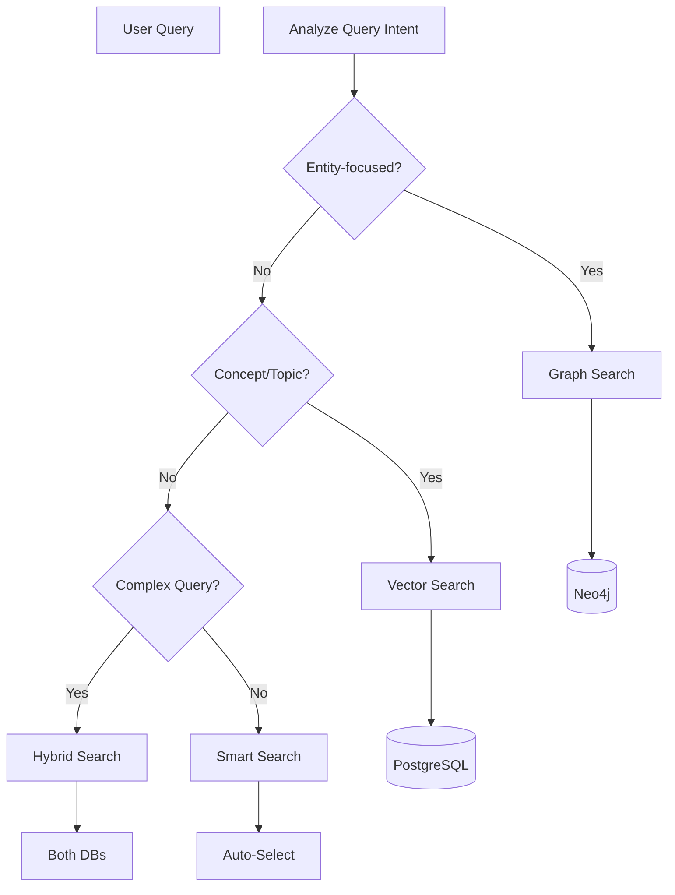
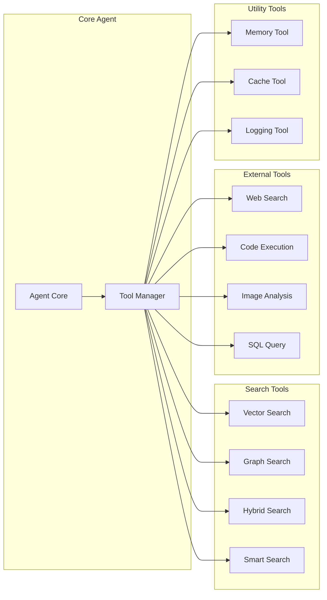
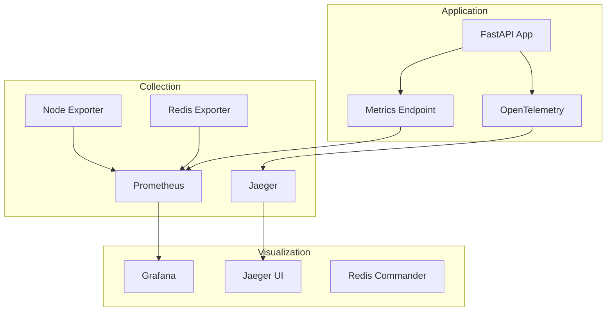
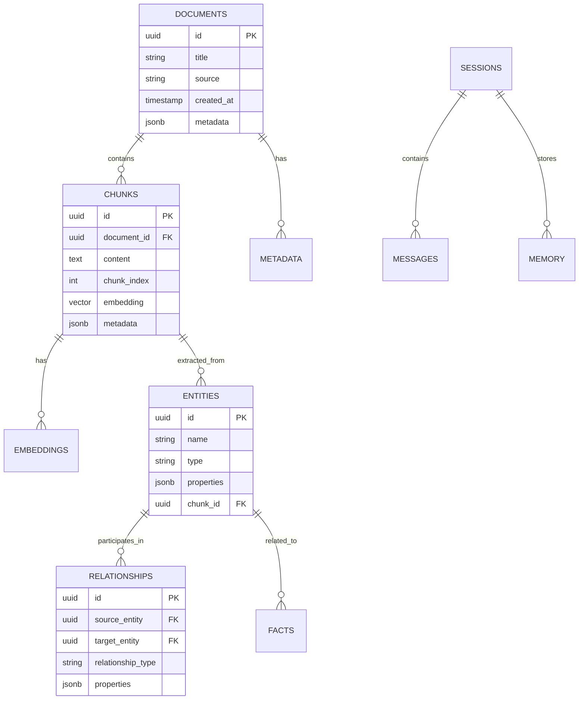
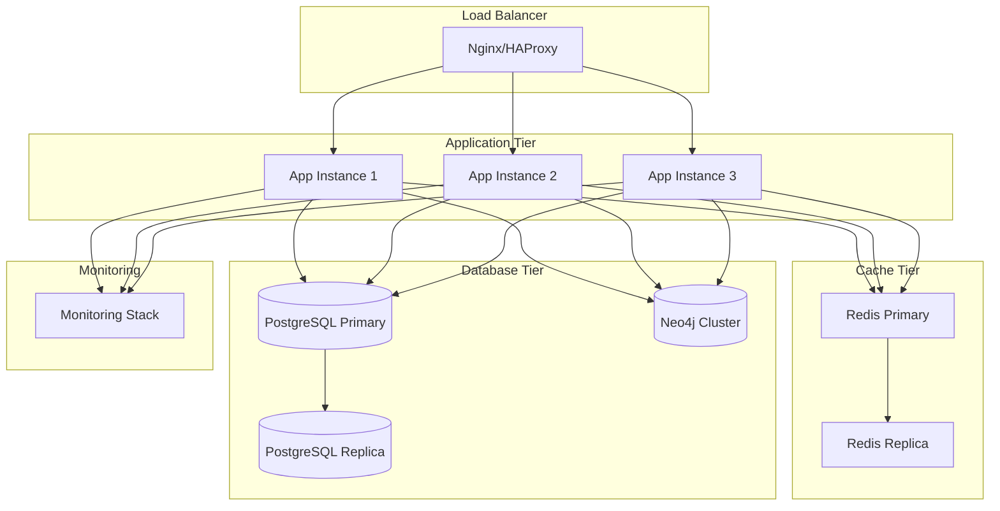
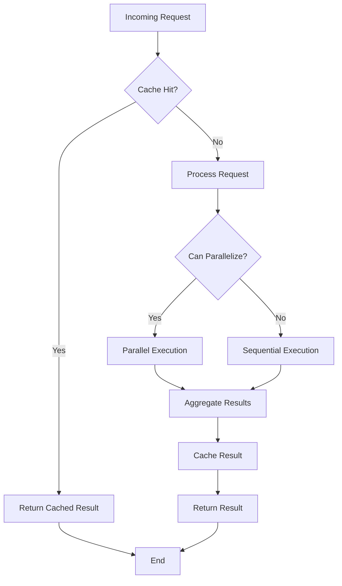

# Architecture Diagrams

This document contains visual representations of the Agentic RAG system architecture using Mermaid diagrams.

## System Overview

## RAG Pipeline Flow

## Ingestion Pipeline

## Search Strategy Decision Tree

## Tool Integration Architecture

## Monitoring Stack

## Database Schema Relationships

## Deployment Architecture

## Performance Optimization Flow

These diagrams provide a comprehensive visual overview of the Agentic RAG system architecture, data flows, and component interactions.
