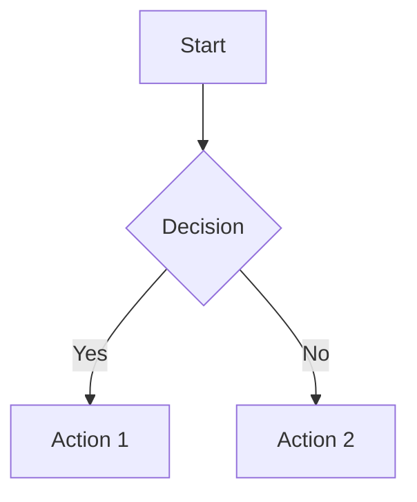

# Tier 3 Development Tools Guide

## Overview

This guide covers the Tier 3 documentation and collaboration tools implemented for the Agentic RAG project. These tools provide comprehensive documentation infrastructure, API testing collections, and visual documentation capabilities.

## Tool Categories

### 1. Documentation Systems
- **Sphinx**: Technical API documentation with auto-generation
- **MkDocs**: User-friendly documentation with Material theme
- **Mermaid**: Architecture and flow diagrams

### 2. API Testing Collections
- **Postman**: Comprehensive API collection with environments
- **Insomnia**: Alternative API testing workspace

## Installation

### Quick Setup

Run the complete Tier 3 setup:

```bash
make tier3-setup
```

This installs all documentation dependencies and Node.js tools.

### Individual Tool Installation

#### Sphinx Documentation

```bash
make docs-sphinx-install
# or manually:
pip install -r docs_sphinx/requirements.txt
```

#### MkDocs Documentation

```bash
make docs-mkdocs-install
# or manually:
pip install mkdocs mkdocs-material mkdocstrings[python] \
    mkdocs-mermaid2-plugin mkdocs-git-revision-date-localized-plugin
```

#### API Testing Tools

```bash
# Postman CLI (Newman)
npm install -g newman

# Insomnia CLI
npm install -g insomnia-inso
```

#### Mermaid CLI

```bash
npm install -g @mermaid-js/mermaid-cli
```

## Usage Guide

### Sphinx Documentation

#### Building Documentation

```bash
# Build HTML documentation
make docs-sphinx-build

# Clean build artifacts
make docs-sphinx-clean
```

#### Serving Documentation

```bash
# Serve at http://localhost:8000
make docs-sphinx-serve

# Auto-rebuild on changes (development)
make docs-sphinx-autobuild
```

#### Key Features

- **Autodoc**: Automatic API documentation from docstrings
- **Napoleon**: Support for Google and NumPy style docstrings
- **Intersphinx**: Cross-references to external documentation
- **Theme**: ReadTheDocs theme for professional appearance
- **MyST Parser**: Markdown support alongside reStructuredText

#### Configuration

Edit `docs_sphinx/conf.py` to customize:
- Theme settings
- Extensions
- API documentation options
- Cross-reference mappings

### MkDocs Documentation

#### Building Documentation

```bash
# Build static site
make docs-mkdocs-build

# Clean build artifacts
make docs-mkdocs-clean
```

#### Serving Documentation

```bash
# Serve at http://localhost:8002
make docs-mkdocs-serve
```

#### Deployment

```bash
# Deploy to GitHub Pages
make docs-mkdocs-deploy
```

#### Key Features

- **Material Theme**: Modern, responsive design
- **Search**: Built-in search functionality
- **Navigation**: Multi-level navigation with tabs
- **Mermaid Support**: Inline diagram rendering
- **Code Highlighting**: Syntax highlighting with annotations
- **Dark Mode**: Automatic light/dark theme switching

#### Configuration

Edit `mkdocs.yml` to customize:
- Navigation structure
- Theme colors and features
- Plugin settings
- Markdown extensions

### API Testing Collections

#### Postman Collection

##### Importing Collection

```bash
# Show import instructions
make api-import-postman
```

Import `api_collections/postman_collection.json` into Postman.

##### Running Tests

```bash
# Run with Newman CLI
make api-test-postman
```

##### Collection Features

- **Environment Variables**: Configurable base URL, API version, session ID
- **Pre-request Scripts**: Dynamic timestamp and request ID generation
- **Test Scripts**: Response validation and performance checks
- **Authentication**: Bearer token support
- **Request Organization**: Grouped by feature area

##### Environments

Create environment files for different stages:
- Development: `api_collections/postman_env_dev.json`
- Staging: `api_collections/postman_env_staging.json`
- Production: `api_collections/postman_env_prod.json`

#### Insomnia Collection

##### Importing Collection

```bash
# Show import instructions
make api-import-insomnia
```

Import `api_collections/insomnia_collection.json` into Insomnia.

##### Running Tests

```bash
# Run with Inso CLI
make api-test-insomnia
```

##### Collection Features

- **Workspace Organization**: Structured request groups
- **Environment Management**: Multiple environment configurations
- **Template Variables**: Dynamic value generation
- **Authentication**: Bearer token and API key support
- **Request Chaining**: Use response data in subsequent requests

### Mermaid Diagrams

#### Rendering Diagrams

```bash
# Render all diagrams to images
make diagrams-render

# Preview in browser
make diagrams-preview
```

#### Diagram Types

Located in `docs/architecture_diagrams.md`:
- System Overview
- RAG Pipeline Flow
- Ingestion Pipeline
- Search Strategy Decision Tree
- Tool Integration Architecture
- Monitoring Stack
- Database Schema Relationships
- Deployment Architecture
- Performance Optimization Flow

#### Integration

##### With MkDocs

Diagrams are automatically rendered in MkDocs documentation:

```markdown

```

##### With Sphinx

Add to `conf.py`:

```python
extensions.append('sphinxcontrib.mermaid')
```

Then use in `.rst` files:

```rst
.. mermaid::

   graph TD
       A[Start] --> B{Decision}
```

## Combined Operations

### Build All Documentation

```bash
# Build both Sphinx and MkDocs
make docs-build-all
```

### Serve All Documentation

```bash
# Start both documentation servers
make docs-serve
```

Servers will run at:
- Sphinx: http://localhost:8000
- MkDocs: http://localhost:8002

### Clean All Documentation

```bash
# Remove all build artifacts
make docs-clean-all
```

### Export OpenAPI Specification

```bash
# Generate OpenAPI spec from FastAPI
make api-export-openapi
```

Creates `api_collections/openapi_spec.json` for API documentation.

## Documentation Validation

### Link Checking

```bash
# Validate all links in documentation
make docs-validate
```

### Spell Checking

```bash
# Check spelling in all documentation
make docs-spell-check
```

## Best Practices

### Documentation Writing

1. **Consistency**: Use consistent formatting and terminology
2. **Examples**: Include code examples and use cases
3. **Cross-references**: Link related topics
4. **Updates**: Keep documentation synchronized with code changes
5. **Versioning**: Tag documentation for releases

### API Collection Management

1. **Environment Variables**: Use variables for configuration
2. **Test Coverage**: Include tests for all endpoints
3. **Documentation**: Add descriptions to requests and parameters
4. **Version Control**: Commit collections with code changes
5. **CI Integration**: Run collection tests in CI pipeline

### Diagram Creation

1. **Clarity**: Keep diagrams simple and focused
2. **Consistency**: Use consistent styling and colors
3. **Updates**: Update diagrams when architecture changes
4. **Accessibility**: Provide text descriptions
5. **Performance**: Optimize complex diagrams

## CI/CD Integration

### GitHub Actions

```yaml
name: Documentation

on:
  push:
    branches: [main]
  pull_request:
    branches: [main]

jobs:
  build-docs:
    runs-on: ubuntu-latest
    steps:
      - uses: actions/checkout@v4
      
      - name: Set up Python
        uses: actions/setup-python@v5
        with:
          python-version: '3.11'
      
      - name: Install dependencies
        run: |
          make docs-install
          npm install -g newman
      
      - name: Build documentation
        run: make docs-build-all
      
      - name: Validate documentation
        run: make docs-validate
      
      - name: Run API tests
        run: make api-test-postman
      
      - name: Upload artifacts
        uses: actions/upload-artifact@v4
        with:
          name: documentation
          path: |
            docs_sphinx/_build/html
            site/
```

### Deployment

#### GitHub Pages (MkDocs)

```bash
# Deploy to GitHub Pages
make docs-mkdocs-deploy
```

#### Custom Server (Sphinx)

```bash
# Build and copy to server
make docs-sphinx-build
rsync -avz docs_sphinx/_build/html/ server:/var/www/docs/
```

## Troubleshooting

### Common Issues

#### Sphinx Build Errors

```bash
# Clear cache and rebuild
rm -rf docs_sphinx/_build
make docs-sphinx-build
```

#### MkDocs Theme Issues

```bash
# Reinstall dependencies
pip install --upgrade mkdocs-material
make docs-mkdocs-build
```

#### Newman Test Failures

```bash
# Verbose output for debugging
newman run api_collections/postman_collection.json --verbose
```

#### Mermaid Rendering Issues

```bash
# Check Mermaid CLI version
mmdc --version

# Update to latest
npm update -g @mermaid-js/mermaid-cli
```

### Performance Optimization

1. **Documentation Build**: Use parallel builds when possible
2. **Caching**: Enable Sphinx and MkDocs caching
3. **Image Optimization**: Compress rendered diagrams
4. **API Tests**: Run tests in parallel with appropriate rate limiting

## Advanced Configuration

### Custom Sphinx Theme

```python
# In conf.py
html_theme = 'custom_theme'
html_theme_path = ['_themes']
```

### MkDocs Plugins

```yaml
# In mkdocs.yml
plugins:
  - search
  - minify
  - git-revision-date-localized
  - mermaid2
  - mkdocstrings
```

### Postman Monitors

Set up automated API monitoring:
1. Import collection to Postman
2. Create monitor from collection
3. Set schedule and notifications
4. Review test results regularly

## Demo

Run the complete Tier 3 demonstration:

```bash
make tier3-demo
```

This will:
1. Start documentation servers
2. Display access URLs
3. Show API collection locations

## Summary

The Tier 3 tools provide a complete documentation and collaboration infrastructure:

- **Sphinx**: Technical API documentation
- **MkDocs**: User-friendly project documentation
- **Postman/Insomnia**: API testing and documentation
- **Mermaid**: Visual architecture documentation

All tools are integrated with the Makefile for easy management and can be incorporated into CI/CD pipelines for automated documentation generation and validation.